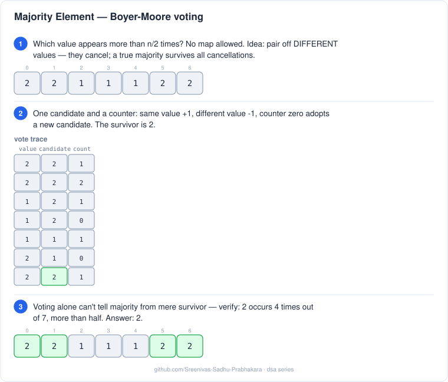

# Majority Element (> n/2 times)

> Striver SDE Sheet 015 · Day 3 Arrays — Boyer–Moore voting: pair off disagreeing elements, the majority survives. Go, stdlib only, tested.

## Problem

Find the element that appears more than ⌊n/2⌋ times in an array, in O(n) time and O(1) space — no hash map, no sort. Report cleanly when no majority exists.

## Approach

Boyer–Moore voting. Keep one candidate and a counter: a matching element votes it up, a differing one votes it down, and at zero the current element becomes the new candidate. The invariant: discarding two *different* elements can never change which value holds the majority, so if a true majority exists it is the surviving candidate. Since the vote alone can't tell "majority" from "mere survivor", a second pass verifies the count — that's what makes the no-majority answer honest.

**Complexity:** O(n) time, O(1) space.

## Visual walkthrough

Read the picture top to bottom — each numbered frame is one moment of the algorithm
running on this repo's test example.

## Run

    go test ./...   # verify
    go run .        # demo

---

One of 191 repos solving Striver's SDE Sheet in Go — stdlib only, one problem per repo, every solution tested. Browse the set: [`dsa-*` repos](https://github.com/Sreenivas-Sadhu-Prabhakara?tab=repositories&q=dsa-&type=source).
